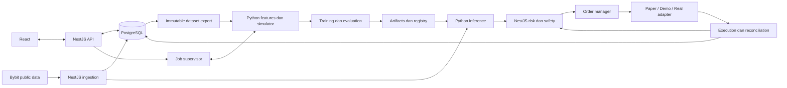

# Arsitektur M0

Tanggal: 5 November 2026, Asia/Jakarta. Status: rancangan M0 diterima melalui
`oke ku approve`; foundation M1 kini diimplementasikan, komponen berikutnya tetap
rancangan. Dasar: [spesifikasi](../PROJECT_SPEC.md) bagian 7–8,
24–33, 36, dan [keputusan](decisions.md).

## Foundation M1 yang sudah diimplementasikan

`apps/api` adalah NestJS 12 ESM dengan ConfigModule (env tervalidasi),
DatabaseService (Prisma 7/PostgreSQL driver adapter), HealthService/Controller,
dan bootstrap loopback. Liveness terpisah dari readiness metadata schema versi 1;
DB failure tidak membuat liveness mengaku dependency sehat.

`services/quant` berisi package src layout dan CLI health JSON dengan Python
3.12 terisolasi. Belum ada worker protocol, features, simulator atau inference.
`scripts/` mengelola portable runtime, setup, cluster lokal dan foundation E2E.
`app_metadata` adalah satu-satunya tabel aplikasi M1; `_prisma_migrations` dikelola
ORM. Tidak ada tabel domain trading/configuration M2 yang dibuat lebih awal.

Versi exact dan archive checksums: [toolchain.json](../toolchain.json), dependency
locks npm/uv. Runtime state/credential berada pada ignored paths, bukan source.
Commands dan batas platform: [operations](operations.md). Verification dan
cleanup proses test sudah lulus; detail [testing](testing.md).

## Komponen dan ownership

| Komponen | Tanggung jawab | Batas |
| --- | --- | --- |
| NestJS API | Konfigurasi, dataset, eksperimen, orchestration job, registry, API dashboard | Tidak menghitung ulang simulator historical |
| NestJS market data | REST/WebSocket, validasi ingestion, persistence, metadata instrumen | Tidak menghasilkan fitur model sendiri |
| Python quant engine | Features, ObservationBuilder, normalisasi, simulator, portfolio historical, reward, RL, evaluation, inference | Tidak mengirim order exchange |
| NestJS trading | Risk live, operational safety, order manager, adapter, reconciliation, audit | Keputusan AI boleh ditolak; bukan pemilik simulator |
| React | Input tervalidasi melalui API, status job, chart, model, monitoring, emergency controls | Tidak menyimpan secret atau memutuskan izin trading |
| PostgreSQL | Metadata dan state persisten | Tabel bertahap, bukan seluruh domain sejak M1 |
| Artifact store lokal | Dataset export immutable, model, preprocessing, laporan | Manifest/checksum, akses hanya melalui ID yang tervalidasi |

State posisi exchange ditentukan dari posisi, order dan executions exchange yang
direkonsiliasi, bukan asumsi dari action terakhir. Backend memegang state operasional;
Python historical simulator memegang state akun virtual pada run yang bersangkutan.
Paper execution akan menggunakan accounting Python melalui adapter/backend order
lifecycle; tidak membangun mesin PnL kedua di TypeScript.

## Data flow



Historical: download → validasi → dataset fingerprint → snapshot konfigurasi →
chronological split → fit preprocessing train saja → simulator yang sama untuk
baseline, RL dan evaluation → artifact + metrics. Final holdout disegel untuk
evaluasi akhir, bukan pemilihan model.

Real-time: closed candle + availability timestamp → Python ObservationBuilder →
kompatibilitas model → inference/action mask → backend memverifikasi account state,
risk dan safety → durable order intent → adapter → status/executions → protective
stop → reconciliation → audit/dashboard. Pemeriksaan safety juga berjalan tanpa
menunggu candle atau inference, khususnya ketika koneksi/stop/state tidak sehat.

## Node.js–Python

Untuk batch M4–M9, backend menjalankan CLI worker Python sebagai subprocess dengan
argument array tanpa shell. Pesan menggunakan JSON Lines di stdout; log di stderr.
Dataset besar dan model dikirim sebagai referensi artifact dengan fingerprint,
bukan payload JSON jutaan candle. Python tidak menerima credential exchange.

Envelope konseptual: `schema_version`, `job_id`, `correlation_id`, `event_id`,
`sequence`, `type`, `timestamp_utc`, `payload`. Jenis pesan: accepted, progress,
checkpoint, completed, failed, cancelled. Satu terminal result per attempt;
pesan tervalidasi, ukuran dibatasi, duplikat dideteksi dan urutan diperiksa.

Backend menyimpan job sebelum spawn, menggunakan satu worker CPU aktif sebagai
usulan awal, membatasi waktu/thread/RAM sesuai kapasitas yang diverifikasi M1/M8.
Checkpoint harus lengkap dan checksum valid sebelum direferensikan. Exit code 0
tanpa completed event dan artifact valid belum berarti job berhasil. Crash membuat
job interrupted/failed; restart tidak otomatis mengulang eksperimen. Cancellation
kooperatif memiliki timeout sebelum terminate proses anak; status terminal disimpan.

Alternatif: FastAPI persisten untuk inference real-time M11, dievaluasi dengan
latency, lifecycle, concurrency dan fault isolation. Protokol, timeout serta health
checks harus ditetapkan sebelum implementasi M11. Redis, broker, Kubernetes dan
distributed training tidak menjadi dependency MVP.

## Shared contracts

Schema lintas bahasa direncanakan di `packages/contracts/`, dengan fixture JSON
yang sama untuk validator TypeScript/Python. Detail ada di [planning](planning.md).
Schema JSON menjadi acuan wire format, bukan dua definisi yang dikelola terpisah.
Generator/validator dipilih setelah compatibility check pada M1/M2.

Harga, quantity dan uang dikirim sebagai string desimal; timestamp UTC epoch
milliseconds; interval `[start, end)`. Perhitungan accounting menggunakan decimal
dengan rounding eksplisit; tensor fitur menggunakan float32 setelah validasi
finite. Nilai yang tidak terdefinisi ditulis null bersama reason, bukan NaN/Infinity.
Snapshot/artifact hash memakai serialisasi kanonis berversi.

## Database konseptual

| Entitas | Relasi dan invariant | Mulai |
| --- | --- | --- |
| Configuration, ConfigurationSnapshot | Draft bisa berubah; snapshot append-only + schema/hash | M2 |
| Symbol, InstrumentMetadata | Exchange/category/symbol + effective timestamp | M3 |
| Candle, Funding | Kunci exchange/category/symbol/interval/open timestamp; provenance revisi | M3 |
| Dataset, DatasetManifest | Range, quality, source version, count, fingerprint; run merujuk versi tetap | M3 |
| Experiment, TrainingJob | Snapshot + dataset + code/dependency version; attempt/status/event | M8 |
| Model, Artifact | Experiment, feature/action schema, normalization, checksum, seed | M8 |
| Evaluation | Model/baseline + split + cost assumptions + metrics/report artifact | M6 minimal, diperluas M9 |
| Deployment | Model/config snapshot, environment, approval, activation, rollback target | M10/M11 |
| OrderIntent, Order | Environment/account/deployment + unique client ID; lifecycle append-only events | M11/M12 |
| Execution | Unique environment/account/execution ID; order FK; qty/price/fee/time | M11/M12 |
| Position, AccountSnapshot | Environment/account/symbol; reconciliation version; bukan sumber fill sintetis | M11/M12 |
| RiskEvent, AuditEvent | Correlation, reason, actor, state transition, timestamp | Bertahap M2–M14 |
| OptimizationTrial | Parent experiment, search space, budget, result/failure | M16 terpilih |

PostgreSQL numeric untuk nilai uang; timestamp timezone-aware dan UTC. Snapshot
immutable secara aplikasi dan database, dengan versioned migration. Historical
candle yang dikoreksi tidak boleh mengubah dataset eksperimen lama: manifest harus
merujuk export/revision tetap, bukan hanya query ke tabel mutable.

Registry mendaftarkan artifact setelah atomic write dan checksum verification;
database dan filesystem tidak diasumsikan satu transaksi. Artifact orphan ditandai
untuk rekonsiliasi. Backup harus memasangkan DB, artifact dan manifest; recovery
test dijadwalkan sebelum trading exchange. Indeks/partition ditentukan dari beban
data M3, bukan diasumsikan perlu sejak awal.

## Struktur folder yang direncanakan

```text
apps/
  api/                 # NestJS modular: config, data, jobs, models, trading
  web/                 # React/Vite; mulai M10
services/
  quant/               # Python: features, simulation, env, training, evaluation, inference
packages/
  contracts/           # Schema berversi dan fixtures lintas bahasa
tests/
  fixtures/            # Market/account/order scenarios deterministik
  integration/         # Workflow lintas proses
infra/                 # Local DB/Compose ketika diperlukan
artifacts/             # Runtime, tidak di-commit
docs/
  handoffs/
```

M0 hanya membuat dokumentasi. M1 telah membuat `apps/api`, `services/quant`,
`scripts` dan local runtime yang ignored; `apps/web`, `packages/contracts`,
features/simulator dan trading tetap rencana. Runtime secret, model dan log
dikecualikan dari Git.

## Deployment dan security

Target awal satu mesin, CPU, pengguna lokal; backend/worker/DB hanya loopback sampai
kontrol akses dirancang. Bind publik memerlukan authentication/authorization dan
review tersendiri sebelum M10/M11. Frontend tidak dapat melewati risk/safety melalui
endpoint langsung. Secret lewat environment/secret store yang dipilih kemudian;
redaction log berlaku untuk error dan request headers juga.

Environment backtest/paper/demo/real bersifat eksplisit dan terpisah dalam config,
credential, namespace state dan adapter. Real tidak resume otomatis setelah restart.
Dedicated bot account disarankan; account yang tidak dapat diverifikasi diblokir.
Runtime/ORM/dependency foundation sudah dipin dan diuji M1. Gymnasium/PyTorch/SB3/
sb3-contrib dipin bersama saat diperkenalkan M7/M8; foundation belum membuktikan
kompatibilitas keseluruhan RL stack.
